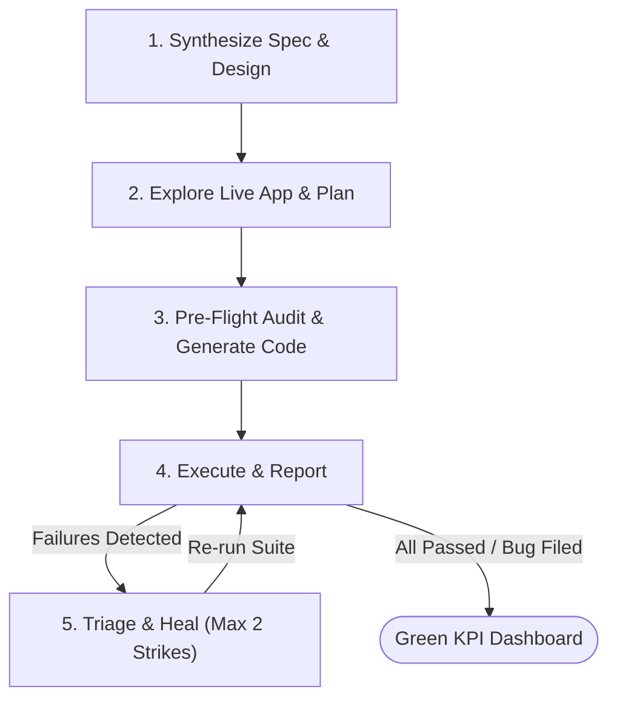
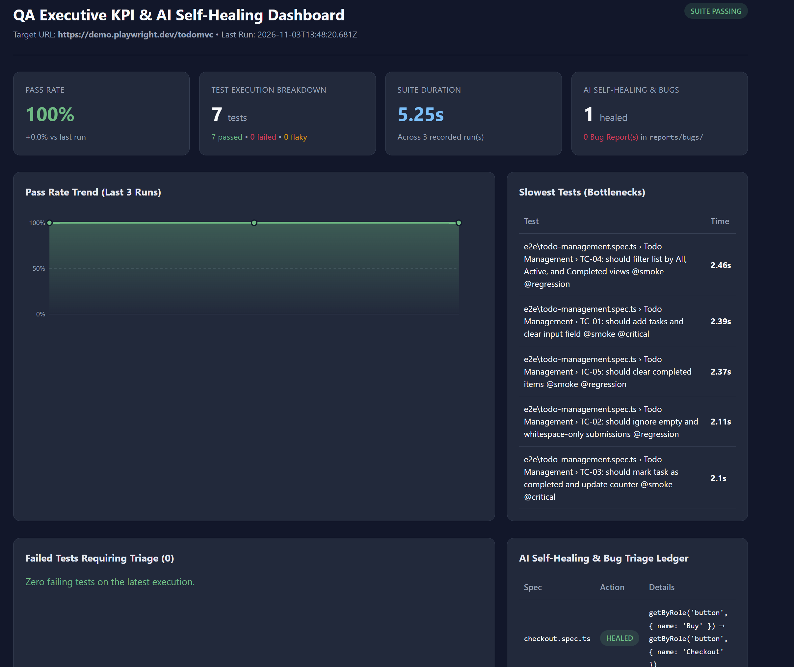

# Agentic QA Automation Blueprint - Playwright + Google Antigravity/Claude Code
*Built as a basic showcase of Agentic QA Automation Architecture.*

A standalone, multi-project **agentic test automation blueprint** built with **Playwright**, **TypeScript**, and **Google Antigravity**. 

Unlike traditional static test suites, this repository treats AI agents as autonomous engineers. It implements a **5-stage state-machine pipeline** with stateless JSON handoff contracts, Model Context Protocol (MCP) tool integration, sacred assertion guardrails (anti-bug-masking), and an executive KPI reporting dashboard.

---

## Architecture & 5-Stage Pipeline



1. **Synthesize Spec & Design (`1-synthesize-spec-and-design`):** Reconciles requirements (Jira MCP / local specs) and designs (Figma MCP) using a strict Hierarchy of Truth, flagging missing inputs and conflicts.
2. **Explore Live App & Plan Cases (`2-explore-and-plan-cases`):** Uses the Playwright MCP server to inspect the live DOM accessibility tree at `BASE_URL` and map resilient locators.
3. **Audit & Generate Code (`3-generate-tests`):** Enforces 100% requirement traceability before generating Page Object Models (POM) and E2E specs adhering to strict coding standards.
4. **Execute & Report (`4-execute-and-report`):** Runs deterministic Playwright tests, generates visual HTML traces, and updates an Executive KPI Dashboard.
5. **Triage & Heal (`5-triage-and-heal`):** Automatically diagnoses failures, applies bounded self-healing (max 2 strikes) for selector drift, or files structured bug reports for real application defects—looping back to Stage 4 until verified.

---

## 📂 Repository Structure

```text
qa-automation-template/
├── AGENTS.md                          # Root AI orchestrator & handoff contracts
├── playwright.config.ts               # Multi-reporter config (HTML, JSON, Traces)
├── package.json                       # CLI shortcuts for test, reports, and pipeline
├── .env.example                       # Environment variables template
├── scripts/
│   └── run-pipeline.mjs               # Stateless 5-stage CLI orchestrator runner
├── .agents/
│   ├── mcp_config.json                # Local Playwright MCP & Remote OAuth (Jira/Figma)
│   ├── rules/                         # Guardrails (sacred assertions & coding standards)
│   └── skills/                        # 5 modular agent SOPs (Stages 1 to 5)
├── specs/                             # Feature requirement Markdown files
├── tests/
│   ├── auth.setup.ts                  # Global auth state setup (.auth/user.json)
│   ├── pages/                         # Page Object Models (POM)
│   └── e2e/                           # Test specification files
└── reports/                           # Ephemeral HTML traces, JSON handoffs, and KPI dashboard
```

---


## 📊 Executive KPI Reporting & Dashboard


Every test execution automatically generates:
1. **Interactive HTML Dashboard:** Time-travel traces and failure screenshots via `npm run report:html`.
2. **Executive KPI Dashboard (`reports/kpi-dashboard.html`):** Built via `npm run report:kpi`, providing a standalone dark-mode executive UI tracking Pass Rate trend charts across runs, slowest test bottlenecks, and AI self-healing audit ledgers.




---

## 🛡️ Key Architectural Guardrails
- **Stateless Context Handoffs:** Each pipeline stage runs in an isolated session and communicates strictly via structured JSON artifacts in `reports/handoffs/`, preventing context rot across long test suites.
- **Anti-Bug-Masking:** The AI Healer is strictly prohibited from mutating business `expect()` assertions to force a green test suite when an application defect exists.
- **2-Strike Healing Cap:** Prevents infinite agent loops by capping automated locator repairs at two attempts before filing a formal bug report in `reports/bugs/`.
- **Zero Hardcoded Secrets:** Credentials and tokens are externalized via environment variables and isolated `.auth/` storage states.

---
